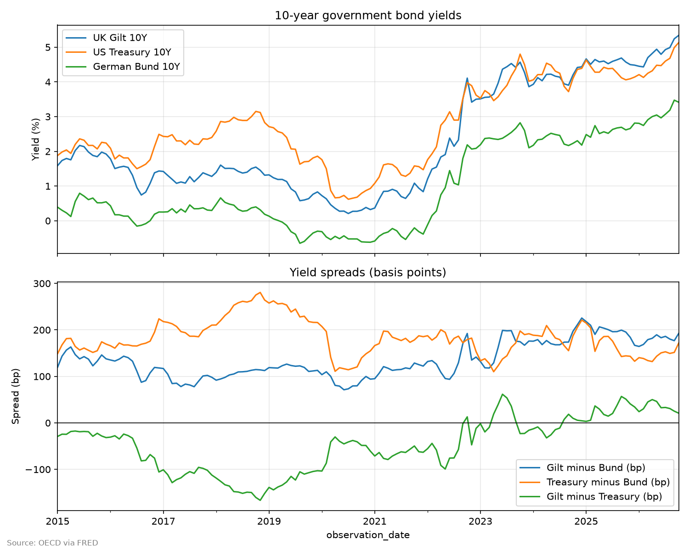

# Government Bond Yield Dashboard: UK Gilts vs US Treasuries vs German Bunds

A Python script that compares 10-year government bond yields for the UK, US and Germany, and calculates the spreads between them.

## What it does
1. Downloads monthly 10-year government bond yields from FRED (OECD data).
2. Plots the three yields on one chart.
3. Calculates and plots the spreads in basis points: gilt vs Bund, Treasury vs Bund, and gilt vs Treasury.
4. Prints the latest yields and spreads.



## How to run
```
pip install pandas matplotlib
python yield_dashboard.py
```
The chart is saved as `yield_dashboard.png`.

## Data and limitations
- Source: OECD monthly 10-year government bond yields, via FRED.
- Only the 10-year point is covered. This is a comparison of yields, not a full yield curve analysis.
- Monthly data, so it does not show daily moves.

## Tools
Python, pandas, matplotlib.

## About this project
I am new to Python and built this project to learn it while studying global fixed income markets. It was developed with AI assistance (Claude), and I worked through the code to understand how it works.

## Possible next steps
- Add 2-year and 30-year yields to build full yield curves.
- Add more countries, such as France and Japan.
- Add an interactive version.
